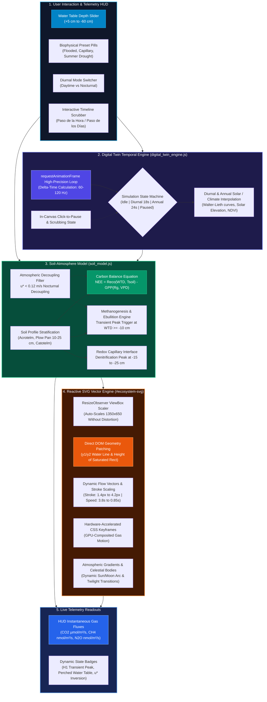

# Digital Twin: Software Architecture & Reactive Engine

The **Wallener Au Peatland Digital Twin** is an interactive, client-side biophysical simulation engine designed to compute and visualize ecosystem carbon and greenhouse gas exchange ($\text{CO}_2$, $\text{CH}_4$, $\text{N}_2\text{O}$) in real time. 

Unlike static video renders or simple chart replays, the Twin functions as an **in-browser deterministic parameter model** running at 60 FPS, with an interactive SVG scene graph, temporal progression state machine, and bidirectional telemetry HUD.

---

## Technical Specifications:

### 1. Zero-Build Vanilla Web Architecture
* **Native ES6 Modules:** No Node.js build pipeline, Webpack, or Babel required. Modern browsers execute modules directly via `<script type="module">`.
* **Zero Graphic Latency:** By utilizing a pure SVG Scene Graph instead of a heavy WebGL/Three.js canvas, memory consumption remains under 30 MB, ensuring instant startup and 60 FPS rendering on all laptops and tablets.
* **Serverless / GitHub Pages Deployment:** Fully static client-side distribution with global edge caching and automated cache busting (`?v=8.0`).

### 2. High-Precision Delta Temporal Engine
* Built with `window.requestAnimationFrame`, capturing frame-to-frame delta time ($\Delta t$).
* Supports full timeline scrubbing and non-destructive pausing: clicking anywhere on the ecosystem canvas immediately halts execution, storing `pausedProgress` and exposing instantaneous biophysical states for academic examination.

### 3. Responsive Proportional Scaler
* The master SVG coordinate space is defined with `viewBox="0 0 1350 650"`.
* A native `ResizeObserver` dynamically scales the canvas width and preserves aspect ratio (`preserveAspectRatio="xMidYMid meet"`), preventing graphic truncation across widescreen presentation displays, tablets, or multi-window layouts.
