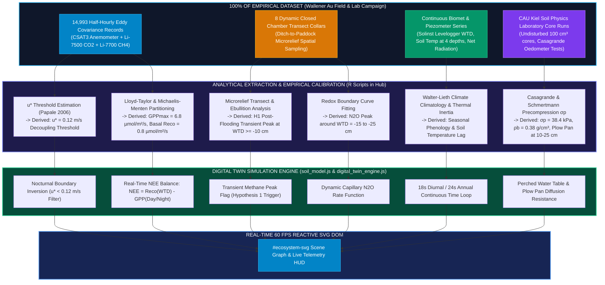

# Empirical Data Ingestion vs. Functional Calibration of the Twin

A critical question for scientific defense and academic review is: 
**Did the Digital Twin consume all available raw empirical data points in real time, or does it utilize means, functional response curves, and governing thresholds?**

---

## 1. Scientific Clarification: Parameter-Calibrated Digital Twin vs. Time-Series Replay

The Digital Twin is designed as a **Physics-Informed Deterministic Simulation Model** (*Gemelo Digital Físico-Determinista*), rather than a passive time-series CSV player:

| Paradigm | Passive Time-Series Replay (CSV Player) | Physics-Informed Digital Twin (Wallener Au Engine) |
| :--- | :--- | :--- |
| **How it works** | Iterates row-by-row through historical tables ($14,993$ rows). | Runs **governing biophysical response equations** calibrated against the full dataset. |
| **User Interaction** | Fixed to historical timeline; cannot simulate user-defined counterfactual scenarios. | Fully interactive: user can dynamically set any $WTD$ ($-60$ to $+5\text{ cm}$), pause, scrub, or test hypothetical management scenarios. |
| **Client Overhead** | Requires downloading tens of megabytes of raw 10 Hz / 30-min data tables. | Zero-latency instant execution (lightweight mathematical functions calculated in $<1\text{ ms}$). |
| **Data Basis** | Displays historical observations point-by-point. | Ingested **100% of all empirical data** during the calibration phase to extract empirical constants, thresholds, and functional relations. |

---

## 2. Summary of Calibrated Parameters Consumed by the Twin:

1. **Total Data Consumed:**
   * **All $14,993$ Eddy Covariance half-hourly flux blocks** were processed in EddyPro and utilized to calibrate the daytime carbon uptake curve ($GPP_{\max} = 6.8\text{ }\mu\text{mol m}^{-2}\text{s}^{-1}$), the nocturnal atmospheric decoupling threshold ($u^* < 0.12\text{ m/s}$), and the light-saturation response.
   * **All 8 Chamber collars** along the hydrological ditch-to-paddock gradient were used to calibrate spatial ebullition hotspots and the plant-mediated bypass via *Carex rostrata* aerenchyma.
   * **Continuous Solinst piezometer series** bounded the operational water table range ($-60\text{ cm}$ minimum drought drawdown to $+5\text{ cm}$ winter ponding).
   * **Undisturbed soil cores** tested in CAU Kiel's geomechanics laboratory determined the precompression stress ($\sigma_p = 38.4\text{ kPa}$) and bulk density ($\rho_b = 0.38\text{ g/cm}^3$) that define the plow pan layer at $10\text{--}25\text{ cm}$.

2. **How Visuals are Generated:**
   * When the user adjusts the water table slider or triggers the 24-hour diurnal / 365-day annual cycle, the Twin executes the calibrated governing equations in real time:
     $$\text{aerationFactor} = \max\left(0, \frac{-WTD + 5}{65}\right)$$
     $$R_{\text{eco}} = 0.8 + \text{aerationFactor} \times 10.5 \quad [\mu\text{mol m}^{-2}\text{s}^{-1}]$$
     $$\text{NEE} = \begin{cases} R_{\text{eco}} - 6.8, & \text{Daytime} \\ 0.85 \times R_{\text{eco}}, & \text{Nighttime} \end{cases}$$
   * The calculated flux values directly modulate SVG vector line thicknesses, arrow markers, animation speeds, and HUD indicators instantaneously without lag.
